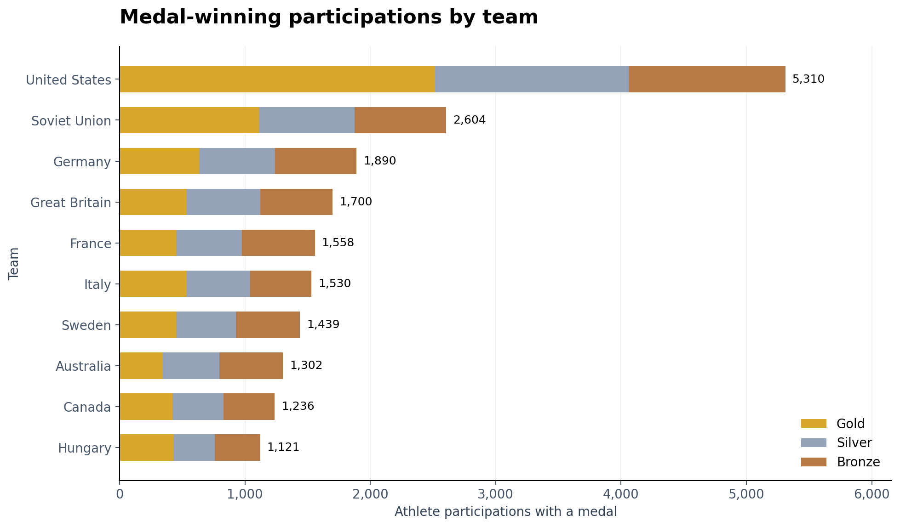
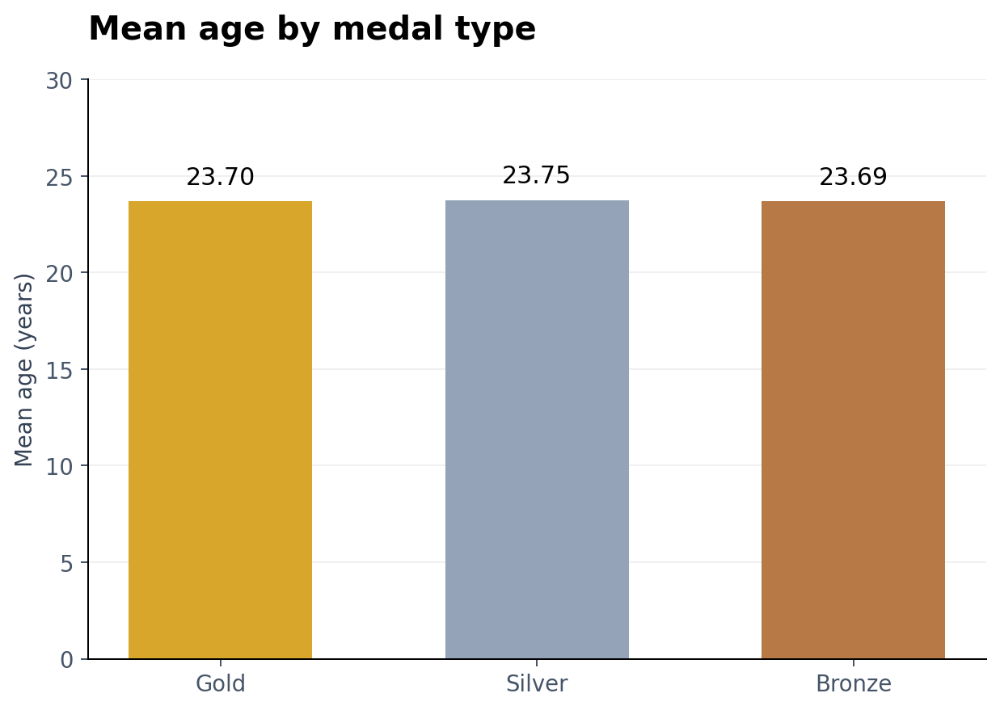
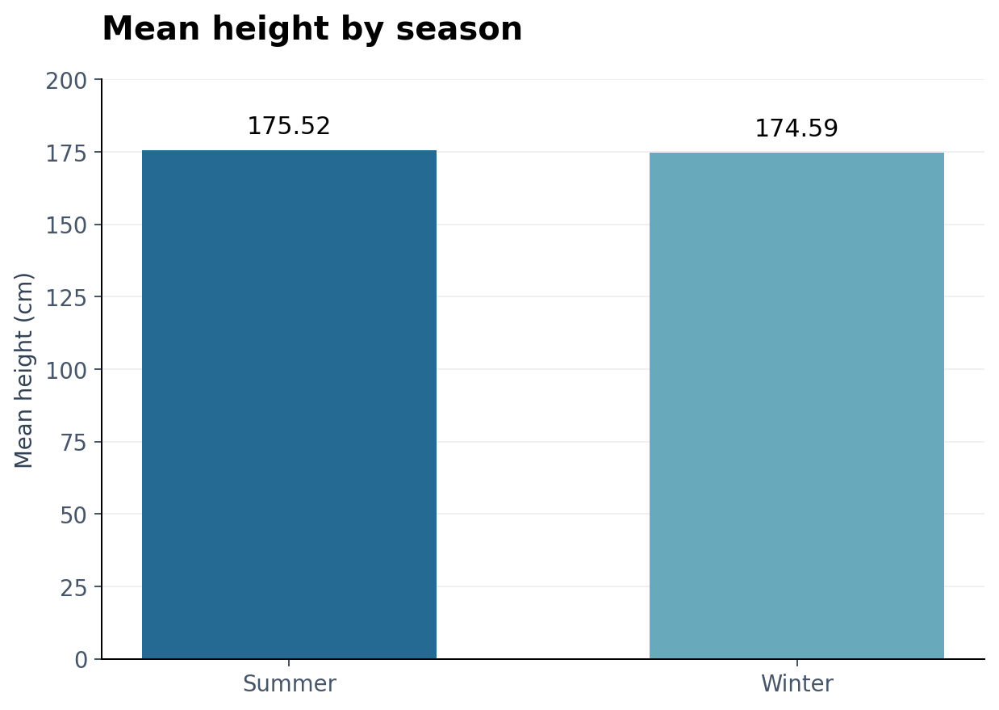
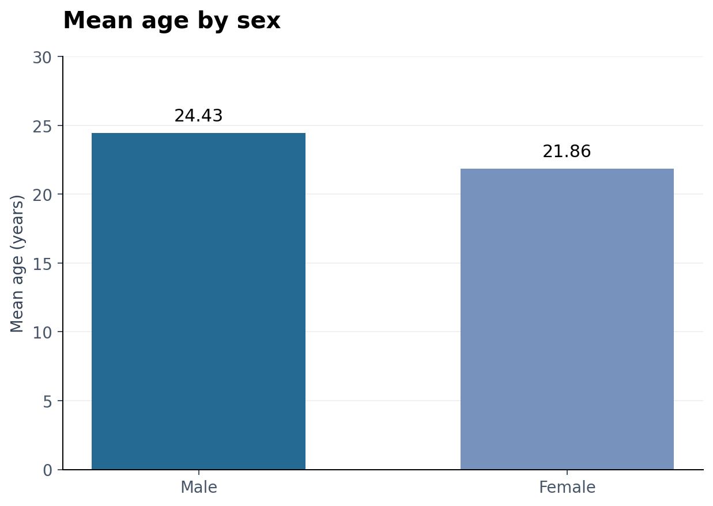
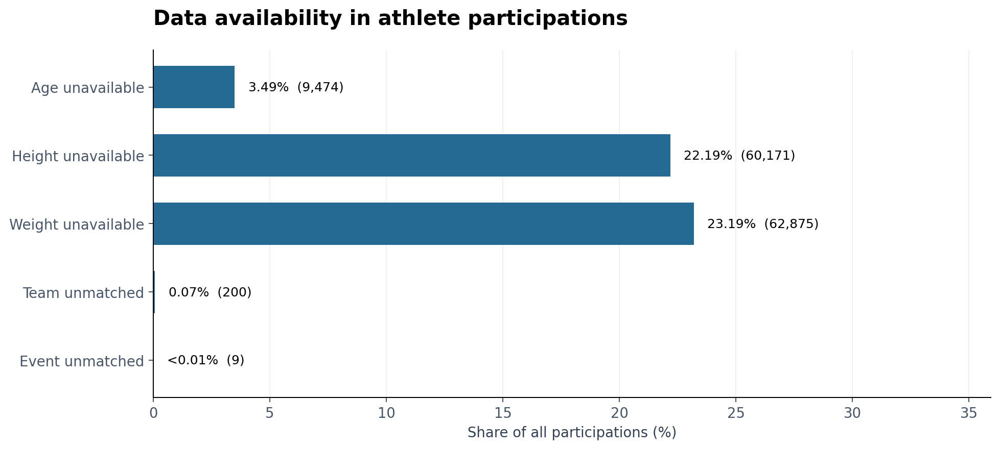
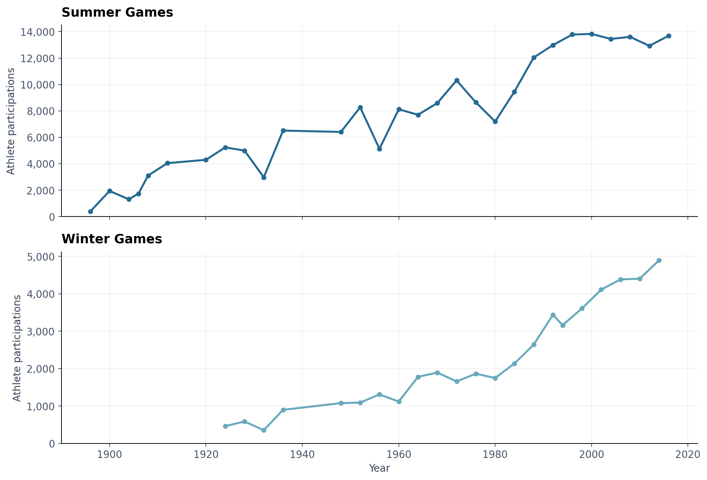

# Taller 1

**Análisis de Grandes Volúmenes de Datos · Parte I**

**Grupo 4: Matías Almonacid y Carolina Castro**

En este taller trabajamos con datos de los Juegos Olímpicos usando PySpark. Partimos de archivos separados de deportistas, equipos, resultados, eventos y ediciones. Los revisamos, unimos la información y calculamos las estadísticas de medallas, edad, altura y sexo.

El desarrollo está en Taller1.ipynb, con las secciones numeradas y el código de los seis gráficos. En la carpeta resultados dejamos las tablas y las imágenes.

## 1. Objetivo del trabajo

La idea es practicar RDD y DataFrames sobre los datos del taller y comprobar qué ocurre en cada paso. Este repositorio corresponde a la Parte I: lectura de archivos, transformaciones, integración, particiones, columnas calculadas y agregaciones.

### 1.1. Qué hicimos

- Cargamos los dos archivos de deportistas como RDD y unimos sus registros.
- Filtramos mayores de edad y mujeres, y transformamos el texto a mayúsculas.
- Creamos los DataFrames y revisamos separadores, nombres y cantidad de campos.
- Unimos las cinco fuentes y distribuimos la tabla integrada en cinco particiones.
- Calculamos el IMC y la descripción del sexo.
- Obtuvimos las cuatro agregaciones solicitadas.
- Guardamos los resultados y armamos seis figuras.

El notebook sigue estos pasos de arriba abajo. Sus secciones usan la numeración 1, 1.1, 1.2, 2, 2.1 y así sucesivamente.

## 2. Archivos del proyecto

| Archivo o carpeta | Qué contiene |
| --- | --- |
| [Taller1.ipynb](Taller1.ipynb) | Desarrollo del taller, explicaciones, tablas y gráficos incluidos. |
| [graficos.py](graficos.py) | Código de las seis figuras, separado en bloques sencillos. |
| [requirements.txt](requirements.txt) | Librerías para ejecutar el proyecto. |
| Los seis archivos de datos en la raíz | Fuentes originales que lee el notebook. |
| [resultados](resultados/) | Tablas CSV, esquema, muestra y detalle completo comprimido. |
| [resultados/figuras](resultados/figuras/) | Las seis imágenes que aparecen más abajo. |
| [docs/datos.md](docs/datos.md) | Descripción de las fuentes, los campos y sus relaciones. |
| [docs/ejecucion.md](docs/ejecucion.md) | Pasos para ejecutar el trabajo y subirlo a GitHub. |

Los datos están junto al notebook porque las celdas los leen por su nombre. Al abrir la carpeta del proyecto, ya quedan en la ubicación que usa el código.

## 3. Datos y decisiones de lectura

### 3.1. Fuentes utilizadas

| Archivo | Información |
| --- | --- |
| [deportista.csv](deportista.csv) | Primera parte del catálogo de deportistas. |
| [deportista2.csv](deportista2.csv) | Segunda parte del mismo catálogo. |
| [resultados.csv](resultados.csv) | Participaciones, medallas y claves para relacionar las fuentes. |
| [equipo.csv](equipo.csv) | Identificadores, nombres y siglas de equipos. |
| [evento.csv](evento.csv) | Catálogo de eventos y sus códigos de deporte. |
| [juegos.json](juegos.json) | Ediciones y temporadas de los Juegos Olímpicos. |

### 3.2. Correcciones que aplicamos

El archivo de resultados usa punto y coma como separador. En deportistas encontramos una fila con un campo vacío adicional al final y lo quitamos al leerla.

El catálogo de eventos contiene 765 registros. Usamos sus códigos para relacionar cada participación con el evento correspondiente.

En juegos ajustamos los nombres para que coincidan con su contenido. La tabla final usa edicion para el texto que combina año y temporada, año para el número y temporada para Verano o Invierno. El archivo entregado no incluye la ciudad sede.

### 3.3. Medidas sin información

Los ceros de edad, altura y peso representan medidas no disponibles. Usamos edades y alturas positivas en sus agregaciones. Para el IMC usamos el peso en kilogramos y convertimos la altura de centímetros a metros.

Las referencias sin correspondencia se conservan mediante uniones izquierdas. Así podemos contar y revisar esas participaciones.

## 4. Cómo ejecutar el proyecto

### 4.1. En Jupyter

Abre una terminal dentro de la carpeta taller-1 e instala las librerías:

~~~bash
python -m pip install -r requirements.txt
python -m notebook
~~~

Abre Taller1.ipynb y ejecuta las celdas en orden. Spark necesita Java. Las primeras celdas importan PySpark, configuran Java e inician la sesión.

Al terminar los gráficos aparece:

~~~text
Resultados guardados en la carpeta resultados/figuras.
~~~

### 4.2. En Google Colab

Carga Taller1.ipynb y los seis archivos de datos en Colab. Para generar las figuras también hace falta subir la carpeta resultados con sus tablas CSV. Las salidas guardadas permiten revisar el notebook antes de ejecutar las celdas.

### 4.3. Volver a generar solamente los gráficos

En Taller1.ipynb, ejecuta la sección 9 desde la celda de preparación. Esa sección lee los CSV incluidos y guarda las seis imágenes en resultados/figuras. Los títulos y ejes están en inglés; los comentarios y las variables están en español.

También dejamos la misma versión de las figuras en graficos.py. Hay más detalles en [la guía de ejecución](docs/ejecucion.md).

## 5. Resumen de resultados

| Indicador | Cantidad |
| --- | ---: |
| Deportistas del catálogo unido | 135.571 |
| Participaciones integradas | 271.116 |
| Participaciones con medalla | 39.783 |
| Equipos del catálogo | 1.184 |
| Eventos del catálogo | 765 |
| Ediciones del catálogo | 51 |
| Particiones de la tabla integrada | 5 |
| Columnas finales | 20 |

Cada fila de la tabla integrada corresponde a una participación. Un deportista puede tener varios registros en diferentes eventos o ediciones. En los deportes colectivos, varios integrantes pueden aportar registros asociados a una misma medalla.

Las cuatro tablas de agregación guardan suma, promedio, mínimo y máximo cuando corresponde. Los ceros se excluyen de las estadísticas de edad y altura.

## 6. Tablas y gráficos

### 6.1. Participaciones con medalla por equipo

Ordenamos los equipos por la suma de oro, plata y bronce. En la figura mostramos los diez primeros; en esta tabla resumimos los cinco con mayor total.

| Equipo | Oro | Plata | Bronce | Total |
| --- | ---: | ---: | ---: | ---: |
| United States | 2.515 | 1.546 | 1.249 | 5.310 |
| Soviet Union | 1.110 | 766 | 728 | 2.604 |
| Germany | 636 | 603 | 651 | 1.890 |
| Great Britain | 531 | 591 | 578 | 1.700 |
| France | 452 | 524 | 582 | 1.558 |

Estados Unidos reúne 5.310 participaciones con medalla. El conteo incluye registros individuales, por lo que los deportes colectivos también aportan varias filas.

### 6.2. Edad por tipo de medalla

Tomamos las participaciones premiadas con edad positiva. Los tres promedios son muy cercanos.

| Medalla | Suma de edades | Promedio, años | Mínimo, años | Máximo, años |
| --- | ---: | ---: | ---: | ---: |
| Oro | 313.374 | 23,70 | 11 | 64 |
| Plata | 304.518 | 23,75 | 11 | 73 |
| Bronce | 308.071 | 23,69 | 10 | 72 |

La diferencia entre el promedio más alto y el más bajo es de 0,06 años. Esta comparación describe las edades registradas; por sí sola no explica por qué una participación obtuvo cierto tipo de medalla.

### 6.3. Altura por temporada

Usamos las alturas positivas y agrupamos por Verano e Invierno.

| Temporada | Suma de alturas, cm | Promedio, cm | Mínimo, cm | Máximo, cm |
| --- | ---: | ---: | ---: | ---: |
| Verano | 29.959.627 | 175,52 | 127 | 226 |
| Invierno | 7.027.252 | 174,59 | 137 | 211 |

Los promedios mostrados difieren en 0,93 cm. Cada temporada reúne deportes y ediciones diferentes, algo que hay que considerar al interpretar el resultado.

### 6.4. Edad por sexo

Agrupamos las edades positivas con las categorías del taller.

| Categoría | Suma de edades | Promedio, años | Mínimo, años | Máximo, años |
| --- | ---: | ---: | ---: | ---: |
| Hombre | 4.581.905 | 24,43 | 10 | 97 |
| Mujer | 1.619.623 | 21,86 | 11 | 74 |

Los promedios mostrados son 24,43 y 21,86 años, con una diferencia de 2,57 años. Como se cuentan participaciones, quien tiene varios registros contribuye varias veces al promedio.

### 6.5. Disponibilidad de los datos

Además de las agregaciones, contamos las medidas no disponibles y las claves sin correspondencia.

| Observación | Participaciones | Porcentaje del total |
| --- | ---: | ---: |
| Edad registrada como cero | 9.474 | 3,49 % |
| Altura registrada como cero | 60.171 | 22,19 % |
| Peso registrado como cero | 62.875 | 23,19 % |
| IMC sin calcular | 64.263 | 23,70 % |
| Equipo sin correspondencia | 200 | 0,07 % |
| Evento sin correspondencia | 9 | 0,00 % |

Una fila puede aparecer en varias de estas observaciones. Los porcentajes se calculan sobre las 271.116 participaciones y no se suman entre sí. La figura muestra cinco indicadores; el detalle de los conteos está en [calidad_datos.csv](resultados/calidad_datos.csv).

### 6.6. Participaciones por edición

Ordenamos las ediciones por año y usamos un panel para Verano y otro para Invierno.

La tabla contiene 29 ediciones de Verano y 22 de Invierno. Las participaciones muestran variaciones entre ediciones; el gráfico permite revisar su evolución sin mezclar las temporadas.

## 7. Resultados guardados

| Archivo | Contenido |
| --- | --- |
| [medallas_por_equipo.csv](resultados/medallas_por_equipo.csv) | Conteos de oro, plata y bronce por equipo. |
| [edad_por_medalla.csv](resultados/edad_por_medalla.csv) | Suma, promedio, mínimo y máximo de edad por medalla. |
| [altura_por_temporada.csv](resultados/altura_por_temporada.csv) | Las cuatro estadísticas de altura por temporada. |
| [edad_por_sexo.csv](resultados/edad_por_sexo.csv) | Las cuatro estadísticas de edad por categoría. |
| [participaciones_por_edicion.csv](resultados/participaciones_por_edicion.csv) | Participaciones, deportistas distintos y registros premiados por edición. |
| [resumen_general.csv](resultados/resumen_general.csv) | Conteos generales y cantidad de particiones. |
| [calidad_datos.csv](resultados/calidad_datos.csv) | Medidas no disponibles y referencias sin correspondencia. |
| [muestra_participaciones.csv](resultados/muestra_participaciones.csv) | Primeras 100 participaciones, ordenadas por identificador. |
| [esquema_integrado.json](resultados/esquema_integrado.json) | Nombres y tipos de las 20 columnas. |
| [participaciones.csv.gz](resultados/participaciones.csv.gz) | Las 271.116 participaciones completas, en CSV comprimido. |

Las imágenes están en resultados/figuras y el detalle completo está en participaciones.csv.gz. La [descripción de resultados](resultados/README.md) explica cómo revisar cada archivo.

## 8. Comentarios finales

La integración conserva las 271.116 participaciones y permite relacionarlas con deportistas, equipos, eventos y ediciones. La revisión de separadores, campos extra y filas entrecomilladas fue necesaria para llegar a las tablas finales.

Las estadísticas de edad por medalla son parecidas. En altura, los promedios por temporada también son cercanos. Las comparaciones son descriptivas y dependen de los deportes, las ediciones y las participaciones presentes en estos archivos.

## 9. Referencias

- Archivos de datos entregados para el taller.
- [Documentación de PySpark](https://spark.apache.org/docs/4.1.2/api/python/index.html).
- [Instalación de PySpark](https://spark.apache.org/docs/4.1.2/api/python/getting_started/install.html).
- [Documentación de Matplotlib](https://matplotlib.org/stable/).
